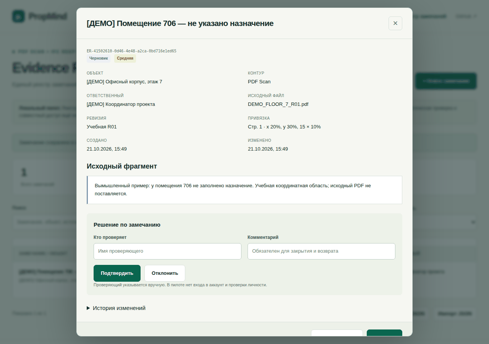

# PropMind · Evidence Register for buildings

**Свяжите замечание по помещению с источником, проверкой и историей решения.**

**Track a room-related finding, its source, human review and decision history.**

Публичный ручной UI-пилот для технических заказчиков, BIM-координаторов и управляющих объектами. Создайте замечание по PDF или IFC, укажите ревизию и координаты, подтвердите учебную запись и перенесите реестр через JSON. Без регистрации; данные остаются в браузере.

[Демо помещения 706 / Room 706 walkthrough](docs/DEMO.md) · [English quick start](#english-quick-start) · [Архитектура / Architecture](docs/ARCHITECTURE.md) · [Как участвовать / Contributing](CONTRIBUTING.md)

[План видимости и обратной связи](docs/COMMUNITY.md) описывает дальнейшие действия после приёмки и публикации.



*Кадры браузерной проверки на вымышленных данных: черновик → учебное подтверждение → новая ревизия и повторная проверка. Capture: synthetic data; the current UI is in Russian.*

Исходный PDF в этом примере не поставляется; автоматическое чтение документов и проверка инженерных норм ещё не подключены.

## Попробовать за несколько шагов

```bash
git clone https://github.com/AlexNovikov77/propmind-design.git
cd propmind-design
python3 scripts/serve.py
```

Откройте **http://127.0.0.1:8080/propmind-design/evidence/**. Для запуска достаточно Python 3.10+ и современного браузера; Node.js 22+ нужен для проверок разработчика. Для этой подготовленной редакции до merge переключитесь на ветку `docs/product-citation-20261020`.

1. Создайте учебное замечание «[ДЕМО] Помещение 706 — не указано назначение».
2. Заполните источник, ревизию и область по [готовому сценарию](docs/DEMO.md).
3. Подтвердите учебную запись, затем измените её: она вернётся на проверку с сохранением истории.
4. Нажмите **Экспорт JSON** — получите переносимый реестр с доказательствами и решениями.

[Версия на GitHub Pages](https://alexnovikov77.github.io/propmind-design/evidence/) соответствует опубликованному `main`; содержание этого PR доступно локально до его приёмки. Сценарий не требует регистрации, рабочего доступа к CRM или клиентских документов.

## English quick start

PropMind is a real-estate lifecycle platform in development. This public repository provides a **manual Evidence Register pilot**: record a finding, a PDF page/region or an IFC element ID, source revision, reviewer and decision history. The current UI is in Russian; the [bilingual room walkthrough](docs/DEMO.md) maps the controls to English.

Run the three commands above and open **http://127.0.0.1:8080/propmind-design/evidence/**. Python 3.10+ is sufficient to serve the UI; Node.js 22+ is only needed for developer checks. To reproduce this proposed revision before merge, check out `docs/product-citation-20261020`.

Try a synthetic room-706 finding, review it, change its content and export JSON. The change returns the reviewed finding to draft while retaining its history. The pilot stores data in the current browser's localStorage. It does not upload source documents, parse PDF/IFC, authenticate reviewers or provide shared team storage. Keep customer documents, personal data and credentials out of public Issues and examples.

**Reuse:** no public software license has been granted for this repository. Public visibility and citation do not grant permission to reuse or redistribute the code; contact the owner before reuse. [Citation instructions](docs/CITING.md) identify the author and exact revision.

If this workflow is useful, a GitHub star helps you bookmark the project. More useful feedback is a reproducible issue describing the document workflow, expected result and observed behavior, using synthetic data.

## Направление платформы

Платформа в разработке: от идеи и проектирования до строительства, продаж, аренды и последующей технической и коммерческой эксплуатации. Общая основа — объекты, помещения, оборудование, документы, процессы и проверяемые доказательства.

Автор и владелец продукта — **Алексей Новиков / Aleksei Novikov**, [@AlexNovikov77](https://github.com/AlexNovikov77).

Этот репозиторий — публичная витрина и UI-пилот PropMind. Здесь можно изучить подход и воспроизвести ручной Evidence Register на вымышленных данных. Приватное ядро, его подготовленные ветки и публичный интерфейс имеют разные уровни готовности.

| Что оценить | Где посмотреть | Граница результата |
|---|---|---|
| Продукт и этапы развития | [Обзор PropMind](docs/PRODUCT.md) | Направление платформы; готовность каждого блока указана отдельно |
| Доказательный реестр | [Исходник UI](evidence/index.html) и локальный запуск ниже | Ручной ввод, проверка человеком, история и JSON import/export |
| Проверяемая архитектура | [Архитектура UI](docs/ARCHITECTURE.md) | Статический пилот без серверной авторизации и автоматического чтения PDF/IFC |
| Авторство и ссылка на версию | [Как цитировать](docs/CITING.md) · [CITATION.cff](CITATION.cff) | Цитирование не является лицензией или подтверждением внедрения |

## Публичный UI-пилот

Публичный UI-пилот: проверка проектной документации, доказательный реестр замечаний и переход от BIM к эксплуатации. Основной Python-код и действующие интеграции находятся в приватном репозитории [propmind](https://github.com/AlexNovikov77/propmind).

Ветка v0.1 превращает два разрозненных HTML-макета в небольшой рабочий пилот. PDF Scan и IFC Deep Check используют общую структуру замечаний. Автоматическое чтение PDF/IFC, AI-проверка и подключение Битрикс24 находятся в очереди разработки.

## Что уже можно использовать

| Раздел | Адрес относительно сайта | Возможности |
|---|---|---|
| Главная | / | Навигация по продукту и концептам |
| Evidence Register | /evidence/ | Создание и редактирование замечаний, фильтры, ручная проверка, статусы и история, JSON import/export |
| Мобильный концепт | /concepts/liquid-glass/ | Сохранённый макет от 5 июля: смена, заработок, сводка руководителя |
| Концепт Битрикс24 | /b24/ | Канбан, Гант, задача и планируемые сценарии автоматизации |

После публикации главная будет доступна по стандартному адресу [GitHub Pages](https://alexnovikov77.github.io/propmind-design/). Пока изменения не перенесены в main, опубликованная страница может показывать прежнюю версию.

## Запуск

Для локального просмотра нужны Python 3.10+ и браузер. Node.js 22+ требуется для проверок разработчика. У приложения нет runtime-зависимостей и этапа сборки. Playwright — dev-зависимость браузерных проверок, закреплённая в package-lock.json.

    git clone https://github.com/AlexNovikov77/propmind-design.git
    cd propmind-design
    python3 scripts/serve.py

Открыть http://127.0.0.1:8080/propmind-design/. Префикс совпадает с GitHub Pages: так локально проверяются вложенные ссылки. Открытие HTML через file:// не поддерживается из-за модулей браузера.

## Первый рабочий проход

1. Открыть Evidence Register и создать замечание. Для черновика достаточно названия и объекта.
2. Указать контур, исходный файл, его ревизию, ответственного и выдержку или описание доказательства.
3. Для PDF заполнить страницу и прямоугольную область в процентах. Для IFC — GlobalId и координаты в метрах в системе исходной модели.
4. Открыть карточку, указать проверяющего и подтвердить замечание после сверки с источником.
5. После устранения добавить комментарий и отметить результат. Неактуальное замечание отклонить с объяснением: история останется.
6. Экспортировать JSON и сохранить его в рабочей папке проекта. Для переноса в другой браузер импортировать этот файл.

Учебные примеры добавляются только по отдельной кнопке и помечены [ДЕМО]. Они не являются результатами анализа реальных документов.

## Хранение и ограничения пилота

- Данные находятся в localStorage текущего браузера, на текущем origin. Пути внутри одного origin используют общий реестр. Другой браузер, устройство, домен или порт не получают его автоматически.
- Очистка данных сайта или приватный режим могут удалить реестр. JSON-экспорт — переносимая резервная копия. Приложение не отправляет содержимое реестра на сервер.
- Импорт сначала проверяет весь файл, затем показывает замену и сохраняет одну копию текущего реестра. При ошибке проверки или записи текущий реестр не заменяется. Копия до импорта не заменяет внешний бэкап.
- Предел пилота: 500 замечаний и JSON до 3 МБ. Доступная квота браузера может закончиться раньше; при этом операция отменяется с сообщением.
- При повреждении сохранённого JSON запись блокируется. Экспорт сохраняет исходные данные для восстановления; они не затираются пустым реестром. Восстановление повреждённого локального хранилища пока выполняется вручную.
- Имя проверяющего вводится вручную. Авторизации, проверки личности, электронной подписи и защищённого от редактирования журнала пока нет.
- Файл источника и изображения не прикрепляются: регистрируются имя, ревизия, фрагмент и координаты. Источники хранятся отдельно. Единицы IFC и ориентацию PDF проверяет человек.

Репозиторий публичный. Клиентскую документацию, заполненные рабочие реестры, персональные данные и ключи доступа сюда не добавлять.

## Проверка изменений

    npm test
    npm run check
    git diff --check

Первый шаг проверяет правила статусов, доказательств и безопасного импорта. Второй — четыре HTML-страницы, локальные ссылки, якоря и синтаксис JavaScript. Workflow Validate site запускает эти проверки и браузерный сценарий для PR и main.

Для проверки в настоящем браузере установить dev-зависимости из lock-файла:

    npm ci --ignore-scripts
    npx --no-install playwright install chromium
    python3 scripts/serve.py

В другом терминале:

    node scripts/browser-smoke.mjs

Браузерный сценарий проверяет компьютер и телефон, создание, подтверждение, повторную проверку после редактирования, импорт, восстановление копии, конфликты вкладок и ошибки хранилища. Снимки сохраняются в игнорируемую папку artifacts/.

## Как вести дальнейшую работу

Публичная видимость репозитория и правила цитирования не предоставляют лицензию на использование или распространение кода. Публичная программная лицензия пока не выдана; условия повторного использования согласуются с владельцем.

Каждая содержательная доработка начинается с задачи, выполняется в отдельной ветке и проходит через PR с проверками. Если запись в GitHub недоступна, подготовленные задачи ведутся в [BACKLOG](docs/BACKLOG.md); выполненное не объявляется опубликованным до проверки main и Pages.

- [Очередь работ и критерии приёмки](docs/BACKLOG.md)
- [Архитектура и формат данных](docs/ARCHITECTURE.md)
- [Правила изменений](CONTRIBUTING.md)
- [Изменения версий](CHANGELOG.md)
- [Владельцы, приёмка и релизы](docs/DEVELOPMENT.md)

Код интерфейса находится в assets/, а правила реестра — в независимом модуле assets/registry.mjs. Оба исходных концепта сохранены; адрес /b24/ остался прежним.

